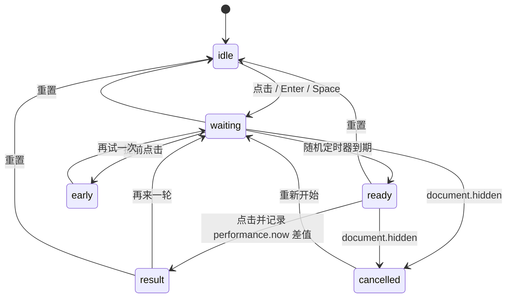

# P1XEL — 霓虹街机网站复刻手册

P1XEL 是独立的街机风格网站，包含真正可以游玩的反应速度挑战、浏览器本地战绩和游戏规则概念卡。它的核心是“看见信号 → 采取行动 → 即时反馈 → 再来一次”，不依赖服务器或其他样例站点。

## 1. 启动、构建与独立部署

在仓库根目录 `/workspace/GptTest` 执行：

```bash
npm ci
npm run dev -- --mode arcade
```

开发服务会持续运行，端口由根目录 `sites.json` 的顺序与 `5173 + index` 决定；以终端输出为准。构建时另开终端：

```bash
npm run typecheck
npm run build -- --mode arcade
python -m http.server 4181 --directory dist/arcade --bind 0.0.0.0
```

`vite.config.ts` 将 root 指向 `apps/arcade/`，产物写入 `dist/arcade/`。仅部署这个产物目录即可独立运行。资源使用相对路径，页面没有依赖远程字体、图片或网络接口。

## 2. 入口与页面结构

| 源码 / 选择器                   | 内容与职责                                              |
| ------------------------------- | ------------------------------------------------------- |
| `index.html`                    | 独立文档、中文语言、响应式 viewport、页面说明与入口脚本 |
| `src/main.tsx` → `App`          | 页面结构、游戏状态、筛选、收藏、规则弹窗、成绩存取      |
| `.hero`、`.hero-art`            | 超大标题、像素外星人、轨道和启动挑战入口                |
| `games`、`.game-grid`           | 1 个可玩的 REFLEX.EXE，3 个明确标为 CONCEPT 的规则预览  |
| `.play-section`、`.game-screen` | 反应挑战的真实交互区                                    |
| `.scoreboard`                   | 本地最好成绩、最近 5 轮平均、最近记录与 JSON 导出       |
| `.club`、`.faq`、`.closing`     | 品牌态度、使用边界说明与下一次游戏入口                  |

## 3. 实际视觉令牌

| 参数              | 当前实现                                                                        |
| ----------------- | ------------------------------------------------------------------------------- |
| 页面底色 / 主文字 | `#131019` / `#f1eef6`                                                           |
| 主要荧光色        | `--lime: #c5ff48`                                                               |
| 紫色强调          | `--purple: #a38df8`                                                             |
| 次级文字 / 细边框 | `--muted: #a09aaa` / `--line: #ffffff16`                                        |
| 字体              | Arial → Noto Sans CJK SC → Microsoft YaHei → sans-serif；微型标签使用 monospace |
| 内容区域          | 最大 `1230px`；桌面左右合计留白 `112px`                                         |
| 首屏标题          | 基础 `111px / .88`，字重 `950`，字距 `-7px`；实际字重取决于可用字体             |
| 手机首屏标题      | `clamp(56px, 18.2vw, 79px)`、字距 `-4.5px`，防止长英文被裁切                    |
| 按钮触感          | 荧光填充、`4px 4px 0 #698c33` 硬阴影；悬停位移 2px 并缩短阴影                   |
| 街机屏幕          | 最小高度 `340px`，深色底、1px 边界与扫描线伪元素                                |

复刻时先建立纯色、排版、网格与信息层级，再添加光线、倾斜和微型标签。微型标签只承担装饰或辅助信息；规则、成绩与操作提示保留可读字号。

## 4. 布局及响应式方法

- 桌面首屏采用 `1.08fr 1fr` 两栏；右侧插画独立承担视觉重心。
- 游戏库桌面四列，760px 以下改为两列；没有把整个桌面页面缩成一张卡片。
- 挑战区域桌面为街机屏幕 + 规则侧栏，760px 以下改为上下排列。
- 成绩区域把两个指标卡与记录表分开；手机端记录表独占一行。
- 断点主要是 1500、1100、760、440px。移动端 `.hero-main > div { min-width: 0 }` 很重要，否则 CSS Grid 的最小内容宽度会把大标题和插画挤出容器。
- `.pixel-site { overflow: hidden }` 用于收住倾斜装饰，**不能用它掩盖真实文字溢出**。验收时还要检查标题文本 Range 的边界，不能只检查 `scrollWidth`。

## 5. CSS / SVG 图形拆解

### 像素角色

`PixelAlien()` 读取 8 × 8 的字符串矩阵。字符 `1` 对应一个 10 × 10 的 SVG `rect`，字符 `0` 留空，最终得到 `viewBox="0 0 80 80"` 的像素角色。

首屏同时渲染 `.alien-main` 和 `.alien-shadow`：主体为淡紫，阴影为深紫，阴影平移 `15px, 20px`；两者共同倾斜 `-12deg`。这是平面图形叠层，不需要 3D 运行时。

### 背景、轨道与贴纸

- `.art-grid` 用两个线性渐变叠出 27px 网格，径向 mask 让边缘变淡。
- `.orbit` 用低透明度椭圆边框和 ±35deg 旋转制造空间关系。
- `PixelStar()` 使用内联 SVG 的阶梯十字轮廓；首屏星芒和横幅分隔符都使用它，避免 Unicode 星号被系统渲染成彩色 emoji。
- `.floating-badge` 使用荧光底、黑色硬阴影和 8deg 倾斜。
- `.player-status` 与右侧贴纸反向倾斜，形成稳定但不规整的构图。

### 四种游戏封面

- `illustration-reflex`：像素 SVG + drop-shadow。
- `illustration-orbit`：三条粗边框椭圆，分别旋转 −30、30、90deg，中间放一个发光圆点。
- `illustration-stack`：五个绝对定位方块，逐层错位并改变亮度。
- `illustration-maze`：带粗边框和重复线性渐变的旋转方框，叠加问号及箭头。

规则预览与封面视觉是原创演示，三个 CONCEPT 卡没有伪装成已实现游戏。

## 6. 反应挑战状态机

`phase` 是唯一的游戏阶段状态：



`play()` 按阶段决定行为：

1. 若为 `waiting`，清理计时器并进入 `early`，不写成绩。
2. 若为 `ready`，用 `performance.now() - readyAt.current` 得到毫秒数，四舍五入且最小取 1，写入成绩并进入 `result`。
3. 其他阶段开始下一轮，清空本轮结果并进入 `waiting`。
4. 标准模式等待 `1500 + Math.random() * 2500` 毫秒；耐心模式等待 `2500 + Math.random() * 3000` 毫秒。
5. 定时器到期时保存 `readyAt` 并进入 `ready`。绿色背景和巨大 `NOW!` 同时反馈，避免只靠颜色判断。

整个 `.game-screen` 使用原生 `<button>`，浏览器自然支持鼠标、触摸、Enter 与空格，不需要另写容易重复触发的键盘监听。

计时器 ID 和开始时间放在 ref，避免因渲染而丢失。模式按钮在 `waiting/ready` 期间禁用；重置和组件卸载都会清理定时器。

### 后台取消

页面监听 `visibilitychange`。当 `document.hidden` 且正在 `waiting/ready` 时，清理定时器并改为 `cancelled`。只切换到其他窗口但页面仍未被浏览器标记为 hidden，不保证触发；这是 Page Visibility API 的边界。

### 测量边界

结果包含浏览器渲染、事件调度、屏幕与输入设备延迟。`readyAt` 在 React 状态更新前记录，并非硬件测得的画面实际发光时刻。因此只能用于同一设备上的趣味比较，不能作为标准化反应能力测量或严肃排名。

## 7. 持久化与导出格式

localStorage 键：`p1xel-scores`。值是按时间从新到旧排列的数组，最多 30 项：

```json
[
  {
    "ms": 286,
    "date": "2026-11-17T06:00:00.000Z",
    "mode": "标准"
  }
]
```

- `ms`：大于零的有限数字，单位毫秒。
- `date`：ISO 时间字符串；读取时只验证字符串类型。
- `mode`：模式字符串；当前界面只生成 `标准` 或 `耐心`。
- `loadScores()` 对 JSON 解析、数组类型和必要字段做防御检查，异常时返回空数组。
- 写入失败时保留当前会话成绩并显示状态说明，不让存储权限阻止游戏。
- `best` 从所有保留成绩求最小值；`avg` 仅计算最近最多 5 轮平均并四舍五入。
- 游戏收藏 `savedGames` 仅存在 React 会话状态，刷新后重置；它和成绩持久化是不同功能。

“导出成绩单”生成本地 Blob，并下载 `p1xel-scorecard.json`：

```json
{
  "game": "REFLEX.EXE",
  "device": "Browser-local reaction test; not a standardized measurement",
  "scores": [{ "ms": 286, "date": "2026-11-17T06:00:00.000Z", "mode": "标准" }],
  "best": 286,
  "averageLastFive": 286
}
```

没有成绩时导出按钮禁用。下载完成后延迟撤销对象 URL。`clearScores()` 清空当前界面数组并删除存储键；它直接执行清除，正式产品可按需要增加撤销或确认流程。

## 8. 复刻顺序

1. 按页面结构建立语义 HTML 和锚点，先确保每个导航都有目标。
2. 建立暗底 / 荧光 / 紫色令牌，调好首屏字宽和段落行高。
3. 完成两栏首屏、四列游戏库、挑战工作区和成绩区域。
4. 绘制像素角色和四个静态封面；逐个检查手机尺寸。
5. 独立完成状态机，再接入动态颜色、提示文案和结果显示。
6. 加入持久化、失败说明和导出，不把成功状态建立在存储权限之上。
7. 实现筛选、收藏、原生规则弹窗和 FAQ。
8. 加入焦点、跳过链接、减少动态效果与移动端导航。
9. 完成下面的验收后，再扩展新的游戏或视觉变体。

## 9. 可重复验收

1. 桌面 1440px、手机 390px 各浏览完整页面；检查标题没有裁字，游戏区不横向滚动。
2. 按 Tab，确认出现“跳到主要内容”；可使用键盘打开导航、规则弹窗并用 Escape 关闭。
3. 开始后立刻再次点击，必须出现 `TOO SOON.`，记录数不增加。
4. 重新开始，等待绿色 `NOW!`，点击或空格后出现毫秒成绩，记录表新增一行。
5. 刷新页面，确认最好成绩与本地记录仍在；切换模式再玩一轮，确认模式记录正确。
6. 等待过程中切换标签页再回来，确认出现 `PAUSED.`，没有新增成绩。
7. 下载成绩单，打开 JSON 并对照界面成绩、最好值和平均值。
8. 清空本地成绩，刷新后仍为空；若浏览器禁用存储，应有可读反馈。
9. 收藏一张概念卡，切换“已收藏”应只显示它；取消收藏后出现空状态。
10. 在系统“减少动态效果”模式中，页面不强制平滑滚动；无自动播放或闪烁动画。

已执行的开发验证包括：TypeScript、独立生产构建、抢跑、键盘完成一轮、刷新持久化、JSON 下载读回、规则弹窗、收藏筛选和手机导航。截图位于 `artifacts/reviews/arcade-desktop.png`、`arcade-mobile.png`。完整批次审核结果以 `docs/reviews/BATCH-03.md` 最终记录为准。
